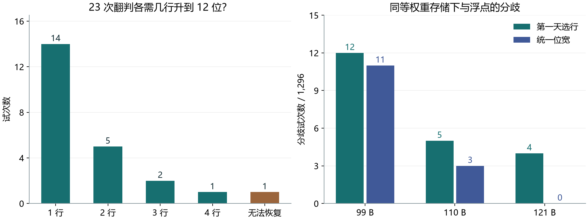

# EEG Precision Audit

运动想象脑电解码中，每行空间滤波权重用多少位才合适？这个仓库复查同一批左右手判断，分别衡量保留浮点模型决策的能力和识别真实提示的准确率。

Across nine participants, a fixed mixed-precision assignment chosen on the training day produced 12, 5 and 4 decisions that differed from a floating-weight reference. Uniform weights at the same three storage budgets produced 11, 3 and 0. The repository includes anonymized aggregate counts, the study code and a data-free verification command.

## 为什么准确率还不够

全部权重用 8 位或全部用 12 位，在第二天的 1,296 个试次中都判对了 962 次。两者却在 **22 次**试验中给出了不同判断，其中各自答对 11 次。要决定硬件究竟应保留什么精度，只看平均正确数会错过这些变化。

## 如果提前知道第二天的结果，能否挑出更好的行？

每人有四行空间滤波权重，每行 22 个。对混合方案，我们分别允许 **1、2、3 行**使用 12 位，其余使用 8 位。每人的行选择在第二天 144 个试次中保持固定。下表是同一批预测与浮点权重参考不同的次数，越少表示越能保留参考判断。

| 每人的权重净存储 | 第一天选行 | 看过第二天后，每人选最佳固定组合 | 同容量全部用统一位宽 |
|---:|---:|---:|---:|
| 99 字节 | 12 | 11 | 11（9 位） |
| 110 字节 | 5 | 4 | 3（10 位） |
| 121 字节 | 4 | 3 | 0（11 位） |

三档预算中，训练日选行距事后可达到的最少分歧都只差 **1 次**。这给继续改进选行方法划出了边界。即便 99 字节这一档两者的最佳计数同为 11，事后最优的混合方案和统一 9 位仍在 **12 个具体试次**上给出了不同类别。事后最优只用于解释这批已观察的数据。表中预算按权重紧密打包计算，尺度和控制开销另计。



## 在本机复核

在仓库根目录用 Python 3.10 或更新版本运行。此检查仅用标准库，读取仓库自带的聚合记录，无需下载脑电或安装硬件工具。

```sh
python verify.py
```

它复算三档预算的固定组合下界，核对 224 行组合统计、72 条分人配置、48 个独立波形复算配置，并运行合成测试。若要重新训练并从原始脑电计算每个试次的判断，请按照[完整复跑步骤](portfolio/eeg-row-restoration/README.md)操作。

## 研究记录

- [中文实验报告](output/bci-row-restoration-2026-11-18/README.md)解释舍入误差如何改变分数和类别，列出逐人和真实标签结果。
- [事后固定组合下界](output/bci-row-restoration-2026-11-18/budget-ceiling.json)列出每人所有并列最优选择。[逐试次配对的汇总](output/bci-row-restoration-2026-11-18/paired-budget-decisions.json)比较两个方案是否在同一个试次上出错。
- [原始定点实验](portfolio/eeg-fixedpoint-audit/README.md)给出训练冻结、数值约定、合成测试和独立点积核的 RTL 检查。新增混合配置与统一 9–11 位的比较使用软件计算。

数据来自 BCI Competition IV-2a（BNCI2014_001）。每人第一天用于训练，第二天用于评分。这组第二天数据在前期研究中已经看过，因此扩展分析属于事后探索。研究问题、等容量比较要求和收敛条件由项目负责人确定，AI 工具参与设计讨论、实现和复查。代码采用 [MIT 许可](LICENSE)。[数据来源与署名](portfolio/eeg-fixedpoint-audit/DATA_NOTICE.md) · [协作说明](portfolio/eeg-fixedpoint-audit/AI_USAGE.md)
