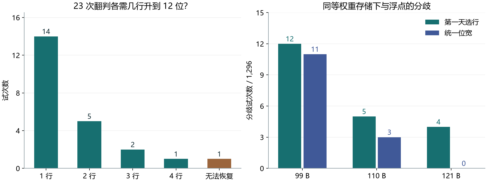

# 同样的脑电解码准确率，哪些判断变了？

2026 年 11 月 18 日 · BNCI2014_001 左右手提示任务 · 九人跨日离线实验

8 位与 12 位空间滤波权重都让分类器答对 962/1,296 次，却在其中 22 次给出了不同的左右手判断。实验逐行改变权重精度，定位了哪些舍入误差让分数跨过分类阈值。接着只用第一天的数据，为每人选定第二天要提高精度的行。三个权重预算下，更简单的统一位宽都保留了更多浮点判断。进一步穷举表明，即使允许事后为每人挑最合适的固定行组合，这种 8/12 位分配在三档预算中的总分歧数也至多追平同容量的统一方案。



## 一次判断是怎样变的

原实验在每位受试者第一天的 144 个试次上训练一个 CSP 空间滤波器和一个 LDA 分类器，以第二天 144 个试次评分，左右手各半。22 路脑电经过滤波后，每一行 CSP 将其按权重合成一条波形，四行分别对 750 个采样点取均方功率和自然对数。LDA 把四个特征乘上各自系数再加上截距，分数大于零判右手，否则判左手。本轮固定原始信号、窗口、量化尺度、四行排序和分类器。[原实验、数值合同与硬件证据](../../portfolio/eeg-fixedpoint-audit/README.md)

主分析固定 16 位输入，以同一输入、原浮点权重的输出为参考。这个参考与全浮点模型在本批的 1,296 个类别上一致，连续分数有差别。每次只将指定行的权重从 8 位提高到 12 位。每行独立计算功率，后端没有跨行归一化，因此把两套保存的特征按行重组，就是同一试次以指定权重计算出的四个特征。提升一行对分数的改变量等于该行的 LDA 系数乘以其特征变化。四行的贡献相加，只有结果跨过零才改变判断。

浮点模型答对 963 次。8 位使 12 次原本正确的判断变错、11 次原本错误的判断改对。12 位只使 1 次原本正确的判断变错。这 1 次也在 8 位的 23 次之中。因此直接比较 8 位和 12 位，两者有 **22 次意见不同，其中各自答对 11 次**。8 位的 23 次分歧出现在 6 人身上，其中 2 人合计 15 次。各人离浮点阈值最近的 15/144 个试次里共有 18 次 8 位分歧，这一排序用到了事后浮点分数。

## 事后知道是哪一行，能解释多少？

四行各自选择 8 或 12 位，一共 16 种组合。下表只看原有的 23 个分歧，每个试次单独找能恢复参考判断的最小组合。

| 至少要升到 12 位的行数 | 1 行 | 2 行 | 3 行 | 4 行 | 所有组合都无法恢复 |
|---|---:|---:|---:|---:|---:|
| 试次数 | 14 | 5 | 2 | 1 | 1 |

那 14 次可以由一行解释，适合恢复的行因人、因试次而异。如果对全批都只升第 3 行，能消除 11 个原有分歧，同时新引入 1 个，留下 13 个。如果允许直接恢复到浮点权重，23 次全部能找回，其中 9 次至少需要两行。唯一的 12 位分歧只需把该人的第 1 行从 12 位恢复到浮点就能消除。跨人的行号仅表示各自模型中的位置。[全部 224 行组合计数](subset-counts.csv)

有两种容易混淆的抵消。上面的「12 坏、11 好」发生在**不同试次**，抵消的是准确率统计。另有 **3 个试次**，全 8 位和全 12 位都与参考一致，部分行升到 12 位时却发生分歧。这是**同一试次**内，把某些行单独改动会使分数跨过阈值的直接证据。

从 8 位到 12 位，1,058/1,296 个试次的四行分数改变量同时有正有负。以“四项改变量的绝对值之和”为分母，计算被抵消的比例，全批中位数为 21.0%，原 23 次分歧中为 1.4%。异号很常见，足以改变类别的抵消只发生在少数试次。[聚合统计与指标定义](aggregate.json)

## 为什么很小的波形误差也能推动分数？

设同一行的参考波形为 z，权重量化引起的波形改变量为 e。对同一窗口的 750 个点取平均，功率改变量满足 **ΔP = 2·平均(z·e) + 平均(e²)**。后一项只看误差有多大，总为非负；前一项还取决于误差与原波形的方向，可以为正也可以为负。在 8 位下，5,184 个「试次 × 行」里有 5,125 个的前一项绝对值更大。因此只看误差自身的均方值，会遗漏这批数据中主要的功率变化来源。

为了跨过对数这一步，我们把两项乘以同一个因子，使两项之和恰好等于该行实际的对数功率变化，再乘冻结的 LDA 系数并跨行求和。按这一定义，8 位全部 23 个分歧里，信号与误差乘积项对分数的贡献绝对值都更大，其中 7 次两项方向相反。这是利用两种精度波形解释已经发生的变化，部署时无法凭低精度输出直接取得参考误差。[波形重算与误差分解核对](moment-check.json)

## 在看到第二天之前能选对行吗？

每人的权重存储预算分别允许升 1、2 或 3 行。只用第一天的数据，优先选与同输入浮点参考分歧最少的组合，用分数均方误差、掩码顺序依次打破平局。九人的组合全部保存后再处理第二天数据。选行时使用模型分数，无需读取提示标签。每行都是 22 个权重，所以在其余行保持 8 位时，上述三种配置与统一 9、10、11 位分别占用相同的紧密打包权重字节数。[对照规则](../../portfolio/eeg-row-restoration/CONTROL.md)

早期单行实验试过另一种选择方法。它计算全 8 位时每行权重舍入对分类分数的平均绝对影响，选择影响最大的一行。两种方法在 8 人身上选中同一行；对第 3 位受试者，早期方法选第 3 行，按第一天分歧数选择则选第 4 行。这两行分别升级时，该人第二天的 144 次判断都与参考一致，因此两种规则在这批数据上得到完全相同的 1,296 个判断。两项计算共用同一批试次。

| 权重净存储 | 升到 12 位的行数 | 均匀选行的期望分歧数 | 第一天选行的分歧数 | 统一位宽的分歧数 | 选行分歧更少／相同／更多的人数 |
|---|---:|---:|---:|---:|---:|
| 99 字节 | 1 | 17.25 | 12 | 9 位，11 | 0／8／1 |
| 110 字节 | 2 | 11.83 | 5 | 10 位，3 | 1／5／3 |
| 121 字节 | 3 | 8.25 | 4 | 11 位，0 | 0／6／3 |

各列均以同一批 1,296 个试次为分母。均匀选行列是预算内所有固定组合的算术平均，可直接穷举。训练日选择优于这一平均值，说明第一天提供了一些有用信息。更简单的统一位宽在三个预算的**总分歧数**上都更低。按真实提示标签衡量，110 字节时选行答对 962 次，统一 10 位答对 960 次；选行对标签多答对两次，同时对原模型少保留两次判断。这两项目标应分别报告。[分人计数、正确数和连续分数误差](equal-storage.json)

两种方案在同一个试次上给出不同答案时，各自保住了什么？用原始窗口的二阶矩重新计算，得到以下逐次配对计数。后四列都只统计第二列中的试次。[重算程序](../../portfolio/eeg-row-restoration/paired_budget_decisions.py) · [完整配对计数](paired-budget-decisions.json)

| 权重净存储 | 训练日选行与统一位宽判断不同 | 仅选行符合浮点 | 仅统一符合浮点 | 仅选行符合真实标签 | 仅统一符合真实标签 |
|---|---:|---:|---:|---:|---:|
| 99 字节 | 13 | 6 | 7 | 6 | 7 |
| 110 字节 | 4 | 1 | 3 | 3 | 1 |
| 121 字节 | 4 | 0 | 4 | 1 | 3 |

统一 11 位在本批与浮点完全同判，统一 12 位却翻了 1 次。12 位相对同输入参考的整体分数均方根误差为 0.00634，低于 11 位的 0.01248。一个恰好靠近零的分数随舍入改变方向，就能让这两个指标给出不同排序。11 位是此次新增的探索对照，原研究预设主配置仍为 12 位。

## 如果事后能挑到最好的固定组合，还能改善多少？

对每位受试者，用第二天全部 144 次判断给每个候选组合计数，取分歧最少的一种，最后把九人的最小值相加。每人每天只允许使用一个固定组合，升级 1、2、3 行时分别枚举 4、6、4 种选择。所有达到最小值的组合同等保留，真实标签只用于另行统计正确数。

| 权重净存储 | 第一天选行的分歧 | 事后选最佳固定组合的最少分歧 | 同容量统一位宽的分歧 |
|---|---:|---:|---:|
| 99 字节 | 12 | 11 | 11 |
| 110 字节 | 5 | 4 | 3 |
| 121 字节 | 4 | 3 | 0 |

在这批数据上，每档预算把「第一天选定」换成「第二天事后选到最佳」最多只能少一次分歧。99 字节时，九人的最佳混合组合各自都与统一 9 位留下相同数量的分歧。110 字节时仍有一人的最佳混合组合优于统一 10 位，但其余八人的结果合并后，统一 10 位总计少一次分歧。这一界限只约束本批固定权重、每人整天固定选行、以参考判定分歧为目标的比较。逐试次切换、其他权重位宽和新的数据各自需要重新验证。[计算程序](../../portfolio/eeg-row-restoration/budget_ceiling.py) · [全体最优组合及并列情况](budget-ceiling.json)

99 字节还有一个容易漏掉的细节。最佳固定混合方案与统一 9 位都偏离参考 11 次，但即使遍历全部并列最佳组合，两种方案在 **12 个试次**上的决定仍然不同。这是先看完第二天再挑组合的结果。上表中的 13 次是第一天就挑好组合的结果。[最佳组合与统一位宽的逐次差异](paired-budget-decisions.json)

## 可以据此作什么决定？

把**定点脑电空间滤波的逐试次决策可靠性**作为作品呈现，保留平均准确率、真实标签、相对浮点的分歧、误差来源与硬件成本五项证据。这次比较提供了暂缓混合精度硬件的具体理由。三档配置各需 66,000 个投影乘积／试次；字节预算只计权重，尺度、对齐、行选择与供数另算。旧 8 位和 12 位点积核映射均用 1 个 DSP，每个点积均需 22 个有效输入沿。本轮新增的 9–11 位及混合配置仅经过软件实验。

这份 E 在 11 月 15 日已被评分，本轮属于事后探索。九人各自训练了模型，同一人的试次相关，以上差值是观察计数。现有结果足以解释这批判断，并让这一条选行策略收尾。若以后提出不同机制，需要使用未参与设计的数据，按确定的决策目标与完整硬件成本重新比较。当前证据支持数值与实现评估，尚不足以确立新算法贡献、临床用途或板级收益。

## 如何核对

原冻结日志共 12,960 个端点预测全部复现，重组分数与保存分数的最大端点差为 3.56×10⁻¹⁵ 以内。两个固定输入条件、七对权重精度、十六种组合、1,296 个试次共得到 290,304 个组合分数，直接使用混合特征和累加逐行改变量两种算法的类别全部一致。独立重读 18 份 T/E 原始 MAT，沿用被冻结的预处理，另行计算量化、点积、选行和分类，全部 27 个训练选择和 72 行按人统计的分类计数吻合。

另从九份 E 原始记录计算每试次 22×22 通道二阶矩阵，代入各组合的真实权重求投影功率，绕开保存的逐行特征。8 位到浮点、12 位到浮点和 8 位到 12 位合计 62,208 次试次与组合对照，判定全部一致，分数最大差低于 4.7×10⁻¹⁴。

在项目根目录运行以下命令即可离线核对表格间的计数关系。原始数据重跑、私有文件和合成测试的步骤见[复现说明](../../portfolio/eeg-row-restoration/README.md)。

```powershell
python portfolio/eeg-row-restoration/check_public_results.py output/bci-row-restoration-2026-11-18
python portfolio/eeg-row-restoration/budget_ceiling.py output/bci-row-restoration-2026-11-18 --check output/bci-row-restoration-2026-11-18/budget-ceiling.json
python portfolio/eeg-row-restoration/test_budget_ceiling.py
```
